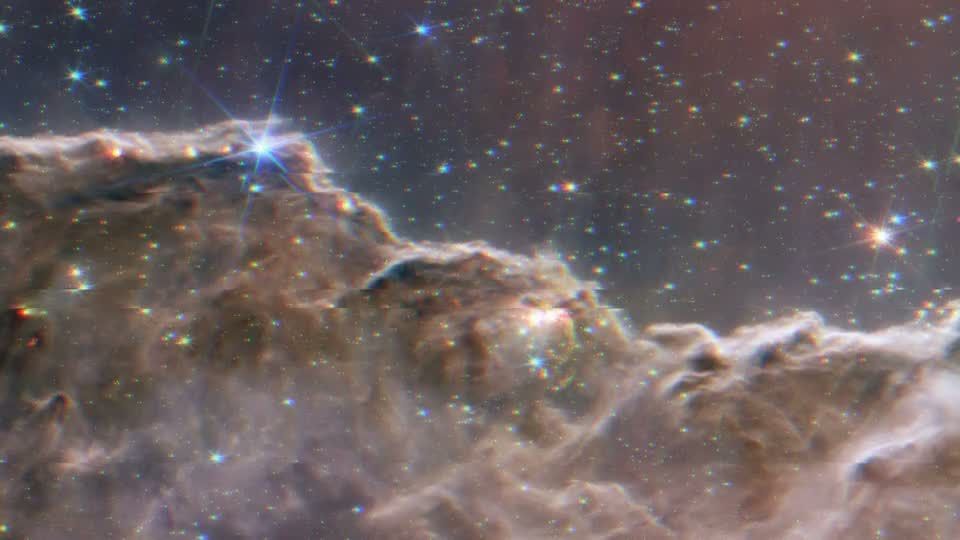
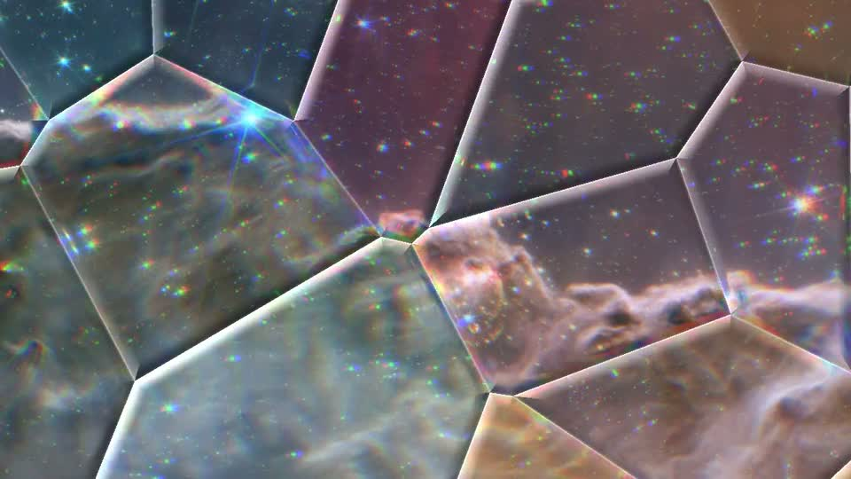

<h1 align="center">
  <br>
  Woofer
</h1>

<p align="center">
  <strong>Your wallpaper, but alive.</strong><br>
  Music-reactive wallpapers for Wayland. Your image. Your music. A desktop that moves with both.
</p>

<p align="center">
  <a href="https://ybucaille.github.io/woofer/#live"><strong>Try the live demo →</strong></a> &nbsp;·&nbsp;
  <a href="#install"><strong>Install Woofer</strong></a> &nbsp;·&nbsp;
  <a href="#presets">Explore the presets</a>
</p>

<p align="center">
  
</p>

<p align="center">
  <strong>13 presets</strong> &nbsp;·&nbsp; Linux / Wayland &nbsp;·&nbsp; Direct PipeWire audio &nbsp;·&nbsp;
  <a href="LICENSE">MIT licensed</a>
</p>

## Keep your wallpaper. Feel your music.

Turn a favourite image into a speaker cone, send ripples across it with every kick, or trade it for a
neon sunset. Woofer listens to your system audio and brings your desktop into the rhythm.

- **Find your mood.** Five wallpaper effects, four overlays and four generative scenes, from a gentle drift to a full RGB glitch.
- **Make it yours.** Use your own image, or follow Caelestia's wallpaper and Material You colours live.
- **Change it live.** Switch presets and tune the intensity from the terminal, without restarting.
- **Let it settle.** Rendering slows after two seconds of silence; fullscreen windows pause their output on Hyprland.

## Install

**You need:** Linux, a Wayland compositor with `wlr-layer-shell`, PipeWire and a Vulkan driver.
Woofer is **tested on Hyprland**. Sway, niri and river are expected to work; reports are welcome.
GNOME and KDE are not targeted.

### Download and run

Get the **Linux x86_64** binary from [Woofer v0.1.0](https://github.com/Ybucaille/woofer/releases/tag/v0.1.0):

```bash
curl -fLO https://github.com/Ybucaille/woofer/releases/download/v0.1.0/woofer-v0.1.0-x86_64-linux.tar.gz
tar -xzf woofer-v0.1.0-x86_64-linux.tar.gz
./woofer-v0.1.0-x86_64-linux/install.sh
```

The installer places the binary in `~/.local/bin` and the presets in `~/.local/share/woofer/shaders`
by default. Make sure `~/.local/bin` is on your `PATH`.
On Arch, the Vulkan driver is `vulkan-intel`, `vulkan-radeon` or `nvidia-utils`, depending on your GPU.

**Start with your favourite image** — replace the path with your own:

```bash
woofer --wallpaper ~/Pictures/wall.jpg --preset woofer
```

Already using swww, hyprpaper or Caelestia's wallpaper? Stop its wallpaper first, or add `--layer bottom`
to draw Woofer above it.

<details>
<summary><strong>Prefer to build from source?</strong></summary>

Requires Git, the current stable Rust toolchain, clang, pkg-config, Wayland and PipeWire development headers,
and a Vulkan driver.
On Arch, install `git rust clang pkgconf wayland pipewire vulkan-icd-loader` plus your GPU's driver.

```bash
git clone https://github.com/Ybucaille/woofer
cd woofer
cargo install --path daemon --locked
mkdir -p ~/.local/share/woofer
cp -r shaders ~/.local/share/woofer/
```

Cargo installs the binary in `~/.cargo/bin` by default; make sure it is on your `PATH`.
See the [build documentation](daemon/README.md#build) for details. AUR and Nix packages are on the [roadmap](ROADMAP.md).

</details>

## Make it your own

With Woofer running, open another terminal to change the look:

```bash
woofer ctl preset ripple
woofer ctl intensity 0.6
```

Pause, resume or check the daemon when you need to:

```bash
woofer ctl pause
woofer ctl resume
woofer ctl status
```

**Use Caelestia's wallpaper and colours:** start Woofer with
`woofer --wallpaper caelestia --preset woofer`.

**Start with your desktop:** add this to your Hyprland configuration:

```ini
exec-once = woofer --wallpaper ~/Pictures/wall.jpg --preset woofer
```

For Sway, use `exec woofer --wallpaper ~/Pictures/wall.jpg --preset woofer`.

**Tune the balance:** `--fps 30` lowers the frame-rate cap, `--idle-fps 0` stops rendering in silence,
and `--scale 0.5` reduces the render resolution. See [all flags and defaults](daemon/README.md#run).

## Presets

**One collection, three ways to change the atmosphere.** All 13 presets are included.
[Try them in your browser](https://ybucaille.github.io/woofer/#live) with your own wallpaper.

| Glitch · distort the image | Shards · layer on glass | Synthwave · build a scene |
|:---:|:---:|:---:|
|  |  |  |

### Animate your wallpaper

| Preset | What it feels like |
|---|---|
| `woofer` | A speaker cone: bass pushes your image out, kicks make it ring |
| `ripple` | A stone dropped into your wallpaper; one clean ring travels out from the centre |
| `glitch` | A brief RGB split and slipped slices on each kick, then calm |
| `drift` | A barely-there breeze, turning into gusts with the mids |
| `heat` | A rising heat haze that shimmers harder with the highs |

### Add another layer

| Preset | What it feels like |
|---|---|
| `aurora` | Northern-light curtains that ripple and brighten with the mids |
| `bokeh` | Soft, out-of-focus lights, each breathing with its own slice of the spectrum |
| `chrome` | Mirror-polished blobs reflecting your wallpaper and swelling with the bass |
| `shards` | Faceted glass: kicks crack it open, highs glint on the bevels |

### Change the whole scene

| Preset | What it feels like |
|---|---|
| `nebula` | Cosmic clouds that bloom on every kick, with stars catching the highs |
| `synthwave` | A neon sunset and a mountain range drawn by the spectrum |
| `ribbon` | A glowing silk ribbon whose waves follow the spectrum |
| `pulse` | Soft concentric rings that breathe with the bass |

## Performance

Measured on an **i7-11800H laptop · Intel UHD · one 1080p output · `pulse` preset**.
CPU figures are percentages of **one core**; memory is resident RAM (RSS).

| State | CPU | RAM |
|---|---:|---:|
| Silence · default settings | 0.48% | ~29 MB |
| Music · 60 fps | 3.0% | ~29 MB |
| Music · 30 fps | 1.8% | ~29 MB |
| Paused | 0.08% | ~29 MB |

With `--idle-fps 0`, the silent test measured **0.00% CPU** with the audio sink suspended.
An open stream playing silence still measured 0.23%. These are measurements on one machine with a light preset,
not a guarantee for every effect or GPU; GPU time was not measured.

[Full results and reproduction method →](daemon/BENCH.md)

## Go further

### Browser preview

The [live demo](https://ybucaille.github.io/woofer/#live) lets you explore presets with a demo beat,
your microphone and your own wallpaper. No daemon installation needed.

<details>
<summary><strong>Run the full preview locally — audio files and video recording</strong></summary>

The local preview also accepts audio files and records 9:16 or 16:9 clips.
From a source checkout, with Node.js, Python 3 and Qt 6 Shader Tools (`qsb`, `qt6-shadertools` on Arch) installed:

```bash
node tools/build.mjs
python3 -m http.server 4420 --bind 127.0.0.1
```

Open [localhost:4420/web/](http://127.0.0.1:4420/web/) for 9:16 recording, or
[the widescreen preview](http://127.0.0.1:4420/web/?rec=wide) for 16:9.
The build step generates both browser and Qt shaders, so it needs `qsb` even for the browser preview.
If `qsb` is elsewhere, use `QSB=/path/to/qsb node tools/build.mjs`.

</details>

### Quickshell / Caelestia module

Prefer to run the effects inside Quickshell? The same presets can sit behind your windows as a Quickshell layer.

<details>
<summary><strong>Set up the Quickshell module</strong></summary>

From a source checkout, with Quickshell, `cava`, Node.js and `qt6-shadertools` installed:

```bash
./install.sh
qs -p quickshell/shell.qml
```

To choose a preset and render scale at launch:

```bash
WOOFER_PRESET=nebula WOOFER_SCALE=0.75 qs -p quickshell/shell.qml
```

To switch the running module from another terminal:

```bash
qs -p quickshell/shell.qml ipc call woofer setPreset ripple
```

`WOOFER_INTENSITY` sets reactivity; `WOOFER_COLORS=default` ignores Caelestia's colours.
The standalone daemon captures PipeWire directly; this module uses `cava`.

</details>

### Write your own effect

One Shadertoy-style `.glsl` file runs in the daemon, the Quickshell module and the browser preview.
Bass, beat, a 16-band spectrum and theme colours are available as inputs.

<details>
<summary><strong>Start with a minimal shader</strong></summary>

Create `shaders/<id>.glsl`:

```glsl
// @name My Effect
// @description One line shown in the picker
// @author you

void mainImage(out vec4 fragColor, in vec2 fragCoord) {
    vec2 uv = fragCoord / iResolution;
    uv += (uv - 0.5) * -0.02 * uBass * uIntensity;
    fragColor = vec4(wall(uv).rgb, 1.0);
}
```

Read the [shader contract](shaders/CONTRACT.md) for uniforms, helpers and effect guidelines.
With Node.js, `qsb` and `glslangValidator` installed, `node tools/build.mjs --check` builds the Qt presets
and validates the browser shaders. See the result in the [local browser preview](#browser-preview).

</details>

## FAQ

**What does it listen to?** Your system output through PipeWire. The daemon captures as a passive node
that never keeps the sink awake. Use `--source <node>` to select another sink.

**Does it work with NVIDIA?** Woofer prefers the integrated GPU by default; `--gpu high` requests the discrete GPU.
Development and measurements use Intel. NVIDIA reports are welcome — include your driver version in an
[issue](https://github.com/Ybucaille/woofer/issues).

**Can I reduce its activity?** Use `--fps 30` for a lower frame-rate cap and `--idle-fps 0` to stop rendering
until sound returns. Fullscreen pause is currently specific to Hyprland.

**Where can I follow development?** See the [changelog](CHANGELOG.md), the [roadmap](ROADMAP.md),
or [report a bug / suggest an effect](https://github.com/Ybucaille/woofer/issues).

## Support Woofer

Woofer is a free, open-source hobby project and will stay free. If it makes your desktop a little nicer,
a star, a screenshot or a bug report helps. You can also [buy me a coffee on Ko-fi](https://ko-fi.com/pivuche),
explore the premium pack or ask about a custom effect.

---

[MIT](LICENSE) · Made by [Ybucaille](https://github.com/Ybucaille) · [Website](https://ybucaille.github.io/woofer/)

Demo wallpaper: “Cosmic Cliffs” in the Carina Nebula, James Webb Space Telescope.
Credit: NASA, ESA, CSA, and STScI ([CC BY 4.0](https://esawebb.org/copyright/)). Shown with Woofer's effects applied.
